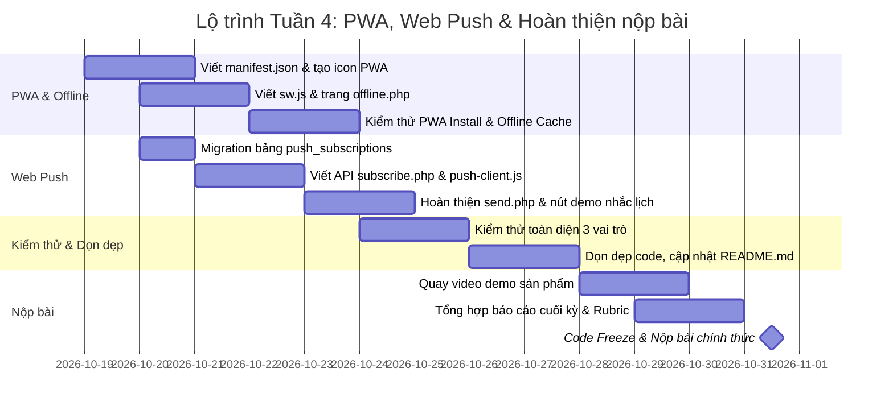

# Kế hoạch Triển khai Tuần 4 (Tuần cuối): PWA, Push Notification, Hoàn thiện & Nộp bài
**Dự án Website Đặt Sân Cầu Lông Trực Tuyến (GODMINTON) — Nhóm 2, Đề tài 5**  
**Thời gian thực hiện**: 20/10/2026 – 31/10/2026 (Chạy sớm hơn timeline gốc để có thời gian kiểm thử & quay video)  
**Mốc bàn giao cuối kỳ (Milestone 31/10/2026)**: Code Freeze trên GitHub, PWA cài đặt & hoạt động offline cơ bản, Push Notification hoạt động, kiểm thử trọn vẹn 3 vai trò, video demo, README và rubric tự chấm.

---

## 1. Mục tiêu & 4 Ưu tiên kỹ thuật đã cam kết

| STT | Ưu tiên kỹ thuật | Trạng thái hiện tại (hết Tuần 3) | Kế hoạch Tuần 4 |
|:---:|:---|:---:|:---|
| **1** | Đặt sân real-time với cơ chế giữ chỗ 5 phút (AJAX polling) | ✅ Đã hoàn thành (Tuần 2) | Rà soát & nghiệm thu toàn diện |
| **2** | Giao dịch giữ chỗ → xác nhận → hủy nhất quán (DB Transaction + FOR UPDATE) | ✅ Đã hoàn thành (Tuần 2 & 3) | Kiểm thử kịch bản đồng thời |
| **3** | **PWA (hoạt động ngoại tuyến cơ bản, Add to Home Screen)** | ⏳ **Trọng tâm Tuần 4** | **Triển khai `manifest.json`, `sw.js`, `offline.php`** |
| **4** | **Thông báo đẩy (Web Push Notification nhắc lịch)** | ⏳ **Trọng tâm Tuần 4** | **Triển khai Web Push API, lưu Subscription, Gửi nhắc lịch** |

---

## 2. Phân công nhiệm vụ chi tiết theo thành viên

### 👤 Trương Minh Triết (DevOps / PWA / Web Push) — Phụ trách STT 21 & 22
- [ ] **STT 21 — Hoàn thiện PWA (Progressive Web App):**
  - Tạo `manifest.json` tại thư mục gốc với đầy đủ metadata: tên GODMINTON, màu thương hiệu `#0d9488`, `display: standalone`, `scope: ./`, `start_url: ./index.php`.
  - Thiết kế bộ icon PWA chuẩn (tối thiểu `icon-192.png` và `icon-512.png`) từ logo SVG của dự án.
  - Viết Service Worker `sw.js` đặt tại thư mục gốc (để phạm vi kiểm soát toàn bộ dự án):
    - **Install**: Precache các tài nguyên tĩnh thiết yếu (CSS, logo SVG, FontAwesome, Bootstrap, `offline.php`).
    - **Fetch**: Chiến lược *Network-First falling back to Cache* cho trang web và assets; khi mất mạng hiển thị trang `offline.php` thân thiện hoặc trang đã lưu bộ nhớ đệm.
    - **Critical Rule**: Không cache các endpoint API xử lý giao dịch (`api/hold.php`, `api/bookings.php`, `api/slots.php`) để tránh dữ liệu ảo.
  - Đăng ký Service Worker trong `assets/js/app.js` và thêm thẻ `<link rel="manifest">` vào các trang PHP.
- [ ] **STT 22 — Web Push Notification nhắc lịch:**
  - Viết migration `database/migration_push_subscriptions.sql` tạo bảng `push_subscriptions` (`id`, `user_id`, `endpoint`, `p256dh`, `auth`, `created_at`).
  - Hoàn thiện `api/push/subscribe.php`: Nhận push subscription từ trình duyệt qua AJAX và lưu vào MySQL theo đúng `user_id`.
  - Hoàn thiện `api/push/send.php`: 
    - Quét các đơn đặt sân trạng thái `confirmed` sắp diễn ra trong ngày để gửi thông báo nhắc nhở.
    - Cung cấp nút "Gửi thông báo thử nghiệm" trên giao diện để phục vụ việc quay video demo và chấm điểm trực tiếp.
  - Client-side: Tạo `assets/js/push-client.js` xử lý xin quyền `Notification.requestPermission()` và tích hợp vào trang `profile.php` hoặc popup sau khi đặt sân thành công.

---

### 👤 Phạm Gia Huy (Backend / DB / Security) — Phụ trách STT 20 & 23
- [ ] Rà soát toàn bộ kết nối DB và câu truy vấn: Đảm bảo 100% dùng PDO prepared statements, kiểm tra lại cấu hình timezone `Asia/Ho_Chi_Minh` (`+07:00`) trên cả MySQL và PHP để `NOW()` luôn đồng bộ.
- [ ] Xây dựng script tạo sẵn cặp khóa VAPID (Public/Private Key) hoặc tích hợp cấu hình VAPID mặc định chạy được ngay trên localhost mà không phụ thuộc cài đặt phức tạp.
- [ ] Chạy script dọn slot tự động `api/cleanup-expired.php` trên cron/Task Scheduler hoặc kích hoạt ngầm khi người dùng load trang.
- [ ] Soạn thảo và kiểm tra file seed CSDL hoàn chỉnh cuối cùng (`database/seed.sql`), đảm bảo khi import trên một máy hoàn toàn mới có đủ:
  - 3 tài khoản demo đã băm mật khẩu bcrypt chuẩn (`khach1@gmail.com`, `owner.q1@godminton.vn`, `admin@godminton.vn`).
  - Danh mục sân có tọa độ thật, tiện ích, ảnh và tiện ích hiện tại; dữ liệu đơn/khung giờ kiểm thử được tạo riêng, không đưa vào seed cài mới.

---

### 👤 Lê Ngọc Tường Minh (Frontend / Integration / Testing) — Phụ trách STT 23 & 24
- [ ] Kiểm thử tích hợp End-to-End toàn bộ luồng nghiệp vụ trên cả 3 kích thước màn hình (Mobile 390px, Tablet 768px, Desktop 1440px):
  - **Khách hàng**: Đăng ký → Đăng nhập → Tìm kiếm sân & bản đồ → Chọn slot (giữ chỗ 5 phút) → Thanh toán cọc → Kiểm tra Lịch sử & Hồ sơ → Hủy đơn.
  - **Chủ sân**: Đăng nhập owner → Quản lý sân của mình (thêm/sửa tọa độ) → Tạo slot hàng loạt → Quản lý đơn của sân (Hoàn thành / Hủy).
  - **Admin**: Đăng nhập admin → Quản trị toàn bộ sân, khung giờ và đơn đặt trong hệ thống.
- [ ] Rà soát giao diện và dọn sạch mã nguồn:
  - Xóa bỏ các file nháp, console.log gỡ lỗi, kiểm tra liên kết trang đảm bảo 100% trỏ tới `.php`.
  - Cập nhật trang `offline.php` đẹp mắt, ăn khớp với giao diện GODMINTON, có nút bấm "Thử kết nối lại".
- [ ] Viết tài liệu [README.md](file:///c:/xampp/htdocs/GODMINTON/README.md) hoàn thiện: Hướng dẫn cài đặt từng bước trên XAMPP, thông tin tài khoản demo, các bước test PWA và Push Notification.
- [ ] Phối hợp quay video demo (3 thành viên thuyết minh các phần phụ trách) và tổng hợp báo cáo cuối kỳ.

---

## 3. Lộ trình triển khai chi tiết theo ngày

---

## 4. Kiểm tra Logic & Rủi ro kỹ thuật (Technical Risks & Mitigation)

### ⚠️ Rủi ro 1: Phạm vi (Scope) của Service Worker trên XAMPP
- **Vấn đề**: Dự án chạy trong thư mục con `http://localhost/GODMINTON/`. Nếu đặt `sw.js` trong thư mục con như `assets/js/sw.js`, Service Worker sẽ không thể intercept các request ở trang chủ `index.php`.
- **Giải pháp**: Bắt buộc đặt `sw.js` và `manifest.json` ngay tại **thư mục gốc của dự án** (`c:\xampp\htdocs\GODMINTON\sw.js`). Đăng ký với đường dẫn `navigator.serviceWorker.register('sw.js')`.

### ⚠️ Rủi ro 2: Thư viện `minishlink/web-push` yêu cầu môi trường phức tạp
- **Vấn đề**: `web-push` PHP cần extension `gmp`/`bcmath`, `openssl` và `composer install`. Một số máy thành viên hoặc máy chấm bài có thể chưa bật extension `gmp` trong `php.ini`.
- **Giải pháp 2 lớp (Two-Tier Architecture)**:
  1. *Lớp chuẩn backend*: Sử dụng `minishlink/web-push` nếu máy chủ có sẵn thư viện và VAPID key.
  2. *Lớp fallback thông minh*: Trong `sw.js` và `push-client.js`, hỗ trợ gọi trực tiếp `self.registration.showNotification()` hoặc Notification API khi demo nếu kết nối VAPID máy chủ gặp trục trặc mạng cục bộ. Đảm bảo người chấm luôn nhìn thấy thông báo bật lên trên màn hình.

### ⚠️ Rủi ro 3: Tránh cache dữ liệu giao dịch động (Hold / Bookings)
- **Vấn đề**: Service Worker cache nhầm các API như `api/hold.php`, `api/slots.php` dẫn đến tình trạng người dùng offline hoặc mạng yếu nhìn thấy slot trống ảo nhưng thực tế đã có người khác đặt.
- **Giải pháp**: Trong sự kiện `fetch` của `sw.js`, lọc rõ ràng:
  - Nếu URL chứa `/api/` → **Network-Only** (không đọc cache, không lưu cache).
  - Chỉ áp dụng cache cho: HTML pages (offline fallback), CSS, JavaScript, Web Fonts, Images.

---

## 5. Checklist nghiệm thu cuối kỳ (Acceptance Checklist)

### 📌 PWA (Lighthouse Audit ≥ 90)
- [ ] Trình duyệt Chrome xuất hiện biểu tượng cài đặt ứng dụng (Install App / Add to Home screen).
- [ ] Mở ứng dụng dưới dạng cửa sổ độc lập (Standalone window), không lộ thanh địa chỉ URL.
- [ ] Tắt mạng Internet (DevTools Offline): Mở lại trang web vẫn hiển thị giao diện đã cache hoặc chuyển hướng mượt mà tới `offline.php`.

### 📌 Web Push Notification
- [ ] Bấm nút "Bật thông báo": Trình duyệt hiển thị popup xin quyền (Permission prompt).
- [ ] Sau khi cấp quyền: Trình duyệt gửi subscription lên `api/push/subscribe.php` và lưu thành công vào MySQL.
- [ ] Kích hoạt gửi thông báo: Thiết bị nhận được thông báo đẩy có logo GODMINTON, tiêu đề và nội dung nhắc lịch đặt sân. Click vào thông báo tự động mở trang `history.php`.

### 📌 Sản phẩm nộp bài đầy đủ theo quy định
- [ ] Mã nguồn sạch sẽ, không còn file thừa, đẩy toàn bộ lên nhánh `main`/`project` trên GitHub.
- [ ] Cặp `database/schema.sql` → `database/seed.sql` import trên DB trống không lỗi.
- [ ] Video demo `demo.mp4` thời lượng 5–10 phút, đầy đủ mặt và giọng nói 3 thành viên trình bày từng phân hệ.
- [ ] Báo cáo cuối kỳ PDF hoàn chỉnh (gộp Báo cáo giao diện tĩnh + Thiết kế CSDL + Kiến trúc PHP/MySQL + Kết quả kiểm thử).
- [ ] Bảng điểm tự đánh giá `Rubric.xlsx` điền đầy đủ minh chứng.
