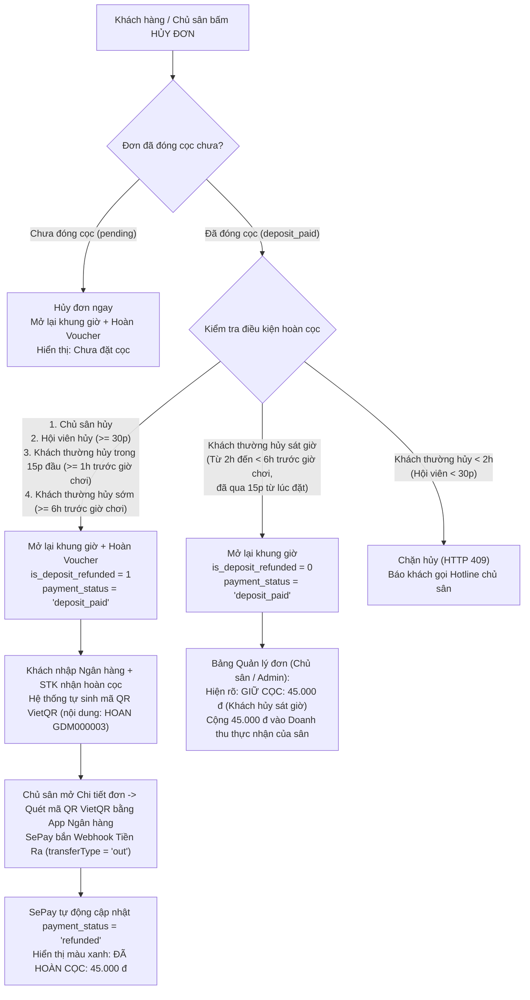

# Luồng Xử Lý Hủy Đơn Đặt Sân & Hoàn / Giữ Tiền Cọc (GODMINTON)

Tài liệu này mô tả chi tiết nghiệp vụ và cách hệ thống **GODMINTON** xử lý khi một đơn đặt sân bị hủy (từ phía Khách hàng hoặc từ phía Chủ sân / Quản trị viên), đặc biệt tối ưu cho cả **khách đặt trước nhiều ngày** lẫn **khách đặt sân đánh ngay trong ngày**.

---

## 1. Bảng Quy Tắc Nghiệp Vụ Khi Hủy Đơn

Khi người dùng hoặc Chủ sân bấm **Hủy đơn**, hệ thống kiểm tra trạng thái thanh toán của đơn (`payment_status`) và thời gian theo thứ tự ưu tiên từ trên xuống dưới:

| STT | Tình huống / Đối tượng hủy | Điều kiện thời gian | Kết quả tiền cọc | Trạng thái DB (`bookings`) | Lý do thực tế |
| :-: | :--- | :--- | :--- | :--- | :--- |
| **1** | **Đơn chưa thanh toán cọc** (`pending`) | Bất kỳ lúc nào trước giờ chơi | **Không phát sinh cọc** | `status = 'cancelled'` `payment_status = 'unpaid'` `is_deposit_refunded = 0` | Khách mới giữ chỗ, chưa chuyển khoản QR nên chỉ cần nhả khung giờ (`available`) và hoàn lại Voucher (nếu có). |
| **2** | **Chủ sân / Admin chủ động hủy đơn** | Bất kỳ lúc nào | **Hoàn cọc 100%** *(Chờ hoàn cọc)* | `status = 'cancelled'` `payment_status = 'deposit_paid'` `is_deposit_refunded = 1` | Lỗi khách quan từ phía sân (bảo trì, mất điện, mưa dột...) nên phải hoàn lại 100% cọc cho khách. |
| **3** | **Khách hàng là Hội viên VIP** *(Bạc / Vàng / Bạch kim)* | Trước giờ chơi **$\ge 30$ phút** | **Hoàn cọc 100%** *(Chờ hoàn cọc)* | `status = 'cancelled'` `payment_status = 'deposit_paid'` `is_deposit_refunded = 1` | Đặc quyền "Hủy khẩn cấp 1 chạm" của Gói Hội Viên. Nếu $< 30$ phút thì chặn hủy trên web, báo gọi hotline chủ sân. |
| **4** | **Khách thường — "Đặt nhầm, Hủy ngay"** *(Ân hạn 15 phút đầu)* | Trong vòng **$\le 15$ phút** từ lúc tạo đơn **VÀ** cách giờ chơi **$\ge 60$ phút** | **Hoàn cọc 100%** *(Chờ hoàn cọc)* | `status = 'cancelled'` `payment_status = 'deposit_paid'` `is_deposit_refunded = 1` | Giải quyết bài toán **khách đặt sân trong ngày** (ví dụ 14h đặt ca 17h) nhưng lỡ chọn nhầm ngày/nhầm sân và bấm hủy ngay lập tức. |
| **5** | **Khách thường — Hủy sớm** | Trước giờ chơi **$\ge 6$ tiếng** *(360 phút)* | **Hoàn cọc 100%** *(Chờ hoàn cọc)* | `status = 'cancelled'` `payment_status = 'deposit_paid'` `is_deposit_refunded = 1` | Dù khách đặt từ hôm trước hay sáng đặt cho ca tối trong ngày, báo hủy trước $\ge 6$ tiếng thì chủ sân vẫn đủ thời gian nhận khách khác. |
| **6** | **Khách thường — Hủy sát giờ** | Từ **$2$ tiếng $\rightarrow$ dưới $6$ tiếng** trước giờ chơi *(và đã qua 15 phút từ lúc đặt)* | **Mất cọc 100%** *(Chủ sân giữ cọc)* | `status = 'cancelled'` `payment_status = 'deposit_paid'` `is_deposit_refunded = 0` | Khách đã giữ chỗ lâu rồi hủy sát giờ thi đấu trong ngày. Khung giờ vẫn mở lại để bán tiếp, và chủ sân giữ tiền cọc (50%) bù rủi ro trống sân. |
| **7** | **Khách thường — Quá sát giờ đấu** | **Dưới $2$ tiếng** trước giờ chơi *(ngoài 15 phút ân hạn)* | **Chặn hủy trên Web** | Giữ nguyên `confirmed` | Quá sát giờ bóng lăn, khách không thể tự hủy trên web mà phải liên hệ trực tiếp số điện thoại chủ sân. |

---

## 2. Sơ Đồ Luồng Xử Lý Từ Lúc Hủy Đến Khi Hoàn Tiền

Vì cổng thanh toán **VietQR / SePay** hoạt động theo cơ chế nhận tiền chuyển khoản 1 chiều (tiền vào tài khoản ngân hàng), việc hoàn trả tiền cọc cần bước xác nhận của Chủ sân sau khi chuyển khoản trả lại khách:

---

## 2.1. Cấu hình SePay Để Tự Động Nhận Diện Giao Dịch Hoàn Tiền (`transferType = "out"`)

1. Đăng nhập vào **[my.sepay.vn](https://my.sepay.vn)** $\rightarrow$ vào mục **Tích hợp Webhooks**.
2. Bấm **Chỉnh sửa** Webhook của `https://godminton.top/api/payments/sepay-webhook.php`.
3. Ở mục **Sự kiện kích hoạt (Loại giao dịch)**, chọn **"Tất cả (Cả tiền vào và tiền ra)"** (thay vì chỉ "Tiền vào").
4. Khi Chủ sân mở chi tiết đơn trên trang Quản lý và dùng App Ngân hàng quét **Mã QR VietQR Hoàn Cọc** của khách (đã điền sẵn số tiền cọc và nội dung `HOAN GDM000003`), ngay khi ngân hàng trừ tiền:
   * SePay bắn Webhook với `transferType = "out"` và `content = "HOAN GDM000003"`.
   * Hàm `payment_process_webhook()` trong [`includes/payment-service.php`](file:///d:/xampp/htdocs/GODMINTON/includes/payment-service.php) tự động đối soát mã đơn + số tiền và chuyển `bookings.payment_status = 'refunded'`, `payments.status = 'refunded'`.

---

## 3. Ví Dụ Minh Họa Thực Tế (Đặt Trong Ngày & Đặt Trước)

1. **Tình huống A — Đặt sáng, chiều tối đánh nhưng trưa bận việc (Đặt trong ngày):**
   * `08:30` sáng khách đặt sân ca `18:00 - 19:00` tối cùng ngày, đã cọc `45.000 đ`.
   * `11:00` trưa khách có việc đột xuất nên vào **Lịch sử đặt sân** bấm **Hủy đơn (Hoàn cọc 100%)** (còn $7\text{ tiếng} \ge 6\text{ tiếng}$).
   * **Kết quả:** Đơn hủy thành công, sân `18:00 - 19:00` mở trống lại ngay. Đơn chuyển sang **`Chờ hoàn cọc: 45.000 đ`** để chủ sân chuyển khoản trả lại cho khách.

2. **Tình huống B — Đặt sát giờ trong ngày nhưng lỡ chọn nhầm sân/nhầm giờ:**
   * `15:00` chiều khách đặt ca `18:00 - 19:00` tối (chỉ còn $3\text{ tiếng}$ trước giờ chơi).
   * `15:06` chiều (6 phút sau khi đặt) khách phát hiện chọn nhầm cơ sở sân nên bấm hủy ngay.
   * **Kết quả:** Nhờ **Quy tắc 15 phút ân hạn sau khi đặt**, khách **vẫn được hoàn cọc 100%** dù lúc đó chỉ còn 3 tiếng nữa là tới giờ chơi.

3. **Tình huống C — Giữ sân cả ngày rồi hủy sát giờ:**
   * `08:30` sáng khách đặt ca `18:00 - 19:00` tối.
   * Đến `15:00` chiều (chỉ còn $3\text{ tiếng}$ trước giờ chơi và đã giữ sân hơn 6 tiếng) khách mới bấm hủy.
   * **Kết quả:** Hệ thống hiện popup cảnh báo trước: *"CẢNH BÁO MẤT CỌC: Đơn chỉ còn dưới 6 tiếng trước giờ thi đấu... Nếu hủy lúc này, bạn sẽ KHÔNG được hoàn lại tiền cọc (45.000 đ)"*. Nếu khách đồng ý hủy, khung giờ được mở lại cho người khác thuê và chủ sân được **Giữ cọc 45.000 đ** (tự động cộng vào doanh thu sân).

---

## 4. Các File Đã Được Cập Nhật Trong Codebase

1. **[`includes/booking-service.php`](file:///d:/xampp/htdocs/GODMINTON/includes/booking-service.php)**:
   * Trong `booking_list()`: Tính toán các cờ `will_refund_deposit`, `cancel_policy_type` (`unpaid`, `member_free`, `grace_15m`, `early_6h`, `late_forfeit`) và quyền `can_refund` cho Chủ sân / Admin.
   * Trong `booking_transition()`:
     * Áp dụng quy tắc 15 phút ân hạn + mốc 6 tiếng + mốc 2 tiếng cho khách thường và mốc 30 phút cho Hội viên.
     * Giải phóng cả khung giờ `booked` lẫn `holding` khi hủy đơn.
     * Bổ sung nhánh trạng thái đích `refunded` để Chủ sân / Admin xác nhận đã chuyển khoản hoàn cọc (`bookings.payment_status = 'refunded'`, `payments.status = 'refunded'`).
2. **[`api/admin/bookings.php`](file:///d:/xampp/htdocs/GODMINTON/api/admin/bookings.php)**:
   * Cho phép phương thức `PATCH` nhận thêm trạng thái `refunded` khi Chủ sân / Admin bấm xác nhận hoàn cọc.
3. **[`assets/js/admin-bookings.js`](file:///d:/xampp/htdocs/GODMINTON/assets/js/admin-bookings.js)**:
   * Tách biệt rõ ràng 4 trạng thái hiển thị ở cột tiền cọc của đơn hủy:
     * `Chưa đặt cọc / Hủy trước khi TT`
     * `Chờ hoàn cọc: 45.000 đ / Cần CK trả khách` *(kèm nút thao tác **"Xác nhận đã hoàn cọc"**)*
     * `Đã hoàn cọc: 45.000 đ / Đã CK trả khách`
     * `Giữ cọc: 45.000 đ / Khách hủy sát giờ`
   * Đồng bộ giao diện trong Modal Xem chi tiết đơn và nút **Xác nhận đã hoàn cọc** ở chân Modal.
4. **[`assets/js/history.js`](file:///d:/xampp/htdocs/GODMINTON/assets/js/history.js)**:
   * Hiển thị rõ trên nút hủy của khách: `Hủy đơn (Hoàn cọc 100%)`, `Hủy khẩn cấp (Hội viên)`, hoặc `Hủy đơn (Mất cọc)`.
   * Hộp thoại xác nhận trước khi hủy thông báo rõ khách được hoàn cọc 100% hay mất cọc.
   * Phân biệt trạng thái `Chờ hoàn cọc 100%` (chủ sân đang xử lý) và `Đã hoàn cọc 100%` (chủ sân đã chuyển trả).
5. **[`api/admin/dashboard.php`](file:///d:/xampp/htdocs/GODMINTON/api/admin/dashboard.php)**:
   * Cộng tiền cọc giữ lại (`deposit_amount`) của các đơn hủy sát giờ (`status = 'cancelled'`, `payment_status = 'deposit_paid'`, `is_deposit_refunded = 0`) vào doanh thu thực nhận của chủ sân (tương tự đơn `no_show` giữ cọc).

